# SQL Assignment III - Clothes Shop

## 1. Project Overview
- **Project:** Clothes Shop Database
- **Name:** UWASE Nadia
- **Student ID:** 202512339
- **Business idea:** a clothes shop that sells products to customers and keeps their orders
- **DBMS:** PostgreSQL (pgAdmin 4)

## 2. Database and Table Design
**Database name:** `uwasenadia_202512339_clothes_shop`

| Table | Purpose | Columns |
|---|---|---|
| customers | people who buy | customer_id (SERIAL, PK), full_name (VARCHAR 100), phone (VARCHAR 35), city (VARCHAR 50) |
| products | clothes for sale | product_id (SERIAL, PK), product_name (VARCHAR 100), category (VARCHAR 50), price (INT), stock (INT) |
| orders | what each customer ordered | order_id (SERIAL, PK), customer_id (INT, FK), product_id (INT, FK), quantity (INT), order_date (DATE), status (VARCHAR 20) |

**Primary keys:** every table has a SERIAL id that PostgreSQL generates, so each row is unique.

**Foreign keys:** `orders.customer_id` -> `customers.customer_id` and `orders.product_id` -> `products.product_id`. They make sure an order cannot exist for a customer or product that is not in the database.

**Relationships:** one customer can make many orders, and one product can be in many orders. The orders table links customers and products, so we do not repeat the customer or product details in every order.

**ERD (generated from pgAdmin before the ALTER TABLE tasks):**

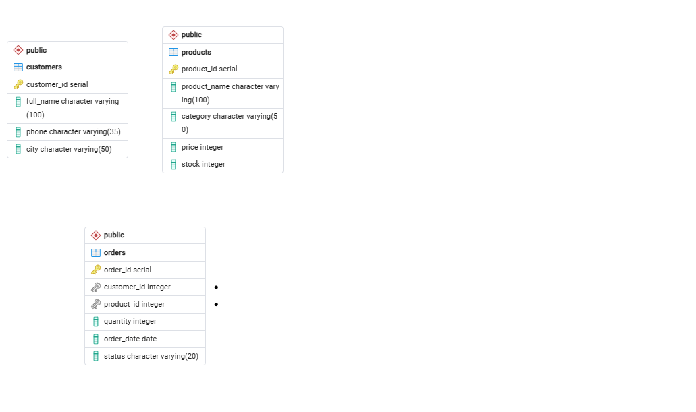

## 3. Database and Table Creation

```sql
CREATE DATABASE uwasenadia_202512339_clothes_shop;

CREATE TABLE customers (
    customer_id SERIAL PRIMARY KEY,
    full_name VARCHAR(100) NOT NULL,
    phone VARCHAR(35),
    city VARCHAR(50)
);

CREATE TABLE products (
    product_id SERIAL PRIMARY KEY,
    product_name VARCHAR(100) NOT NULL,
    category VARCHAR(50),
    price INT CHECK (price > 0),
    stock INT DEFAULT 0
);

CREATE TABLE orders (
    order_id SERIAL PRIMARY KEY,
    customer_id INT NOT NULL REFERENCES customers(customer_id),
    product_id INT NOT NULL REFERENCES products(product_id),
    quantity INT CHECK (quantity > 0),
    order_date DATE DEFAULT CURRENT_DATE,
    status VARCHAR(20) DEFAULT 'pending'
);
```

Constraints used: PRIMARY KEY, FOREIGN KEY, NOT NULL, CHECK, DEFAULT.

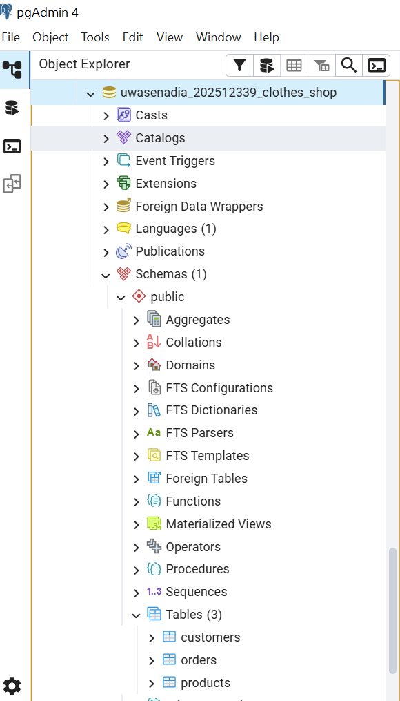

## 4. Initial Data Insertion

```sql
INSERT INTO customers (full_name, phone, city) VALUES
('Aline Uwase', '0788111222', 'Kigali'),
('Jean Habimana', '0788333444', 'Huye'),
('Grace Mukamana', '0788555666', 'Kigali'),
('Eric Nshimiyimana', '0788777888', 'Musanze'),
('Diane Ingabire', '0788999000', 'Rubavu');

INSERT INTO products (product_name, category, price, stock) VALUES
('Blue Jeans', 'Trousers', 15000, 20),
('White T-Shirt', 'Shirts', 6000, 35),
('Black Dress', 'Dresses', 25000, 10),
('Sneakers', 'Shoes', 30000, 15),
('Leather Belt', 'Accessories', 5000, 40),
('Hoodie', 'Jackets', 22000, 12);

INSERT INTO orders (customer_id, product_id, quantity, order_date, status) VALUES
(1, 1, 2, '2026-10-02', 'delivered'),
(2, 4, 1, '2026-10-05', 'pending'),
(3, 3, 1, '2026-10-10', 'pending'),
(1, 2, 3, '2026-10-18', 'delivered'),
(4, 6, 1, '2026-10-22', 'pending'),
(3, 5, 2, '2026-10-23', 'pending');
```

Verification:

```sql
SELECT 'customers' AS table_name, COUNT(*) AS total FROM customers
UNION ALL SELECT 'products', COUNT(*) FROM products
UNION ALL SELECT 'orders', COUNT(*) FROM orders;
SELECT * FROM customers;
SELECT * FROM products;
SELECT * FROM orders;
```

Row counts:

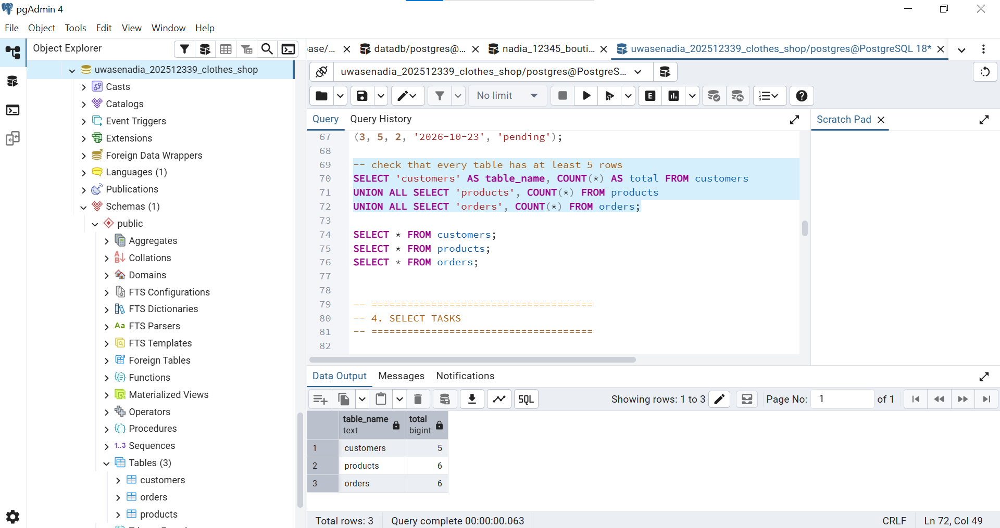

The three tables:


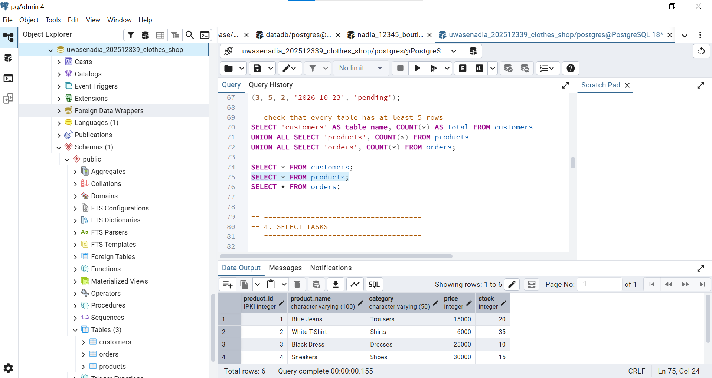
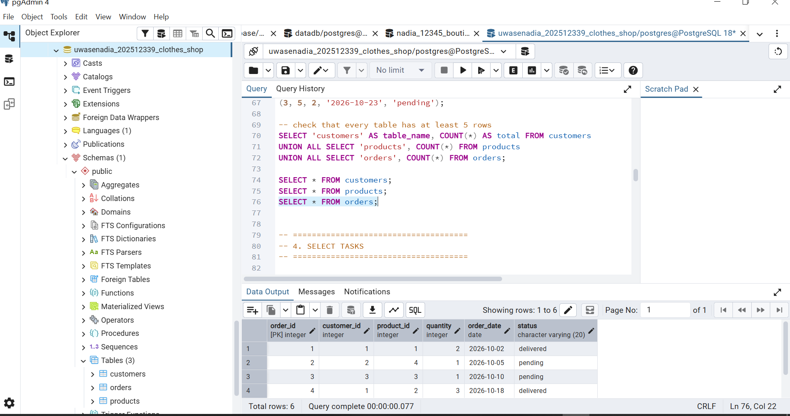

The ids were generated by PostgreSQL (I never typed them), and the orders only use customer and product ids that exist.

## 5. SQL Practical Tasks

### SELECT

**Q1.1** Objective: show name, category and price of all products.

```sql
SELECT product_name, category, price FROM products;
```

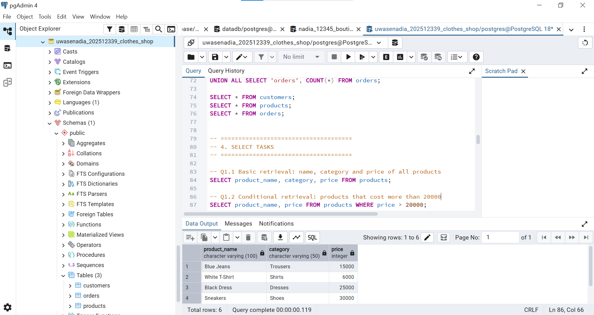

It shows only the 3 columns I chose.

**Q1.2** Objective: find products that cost more than 20000.

```sql
SELECT product_name, price FROM products WHERE price > 20000;
```

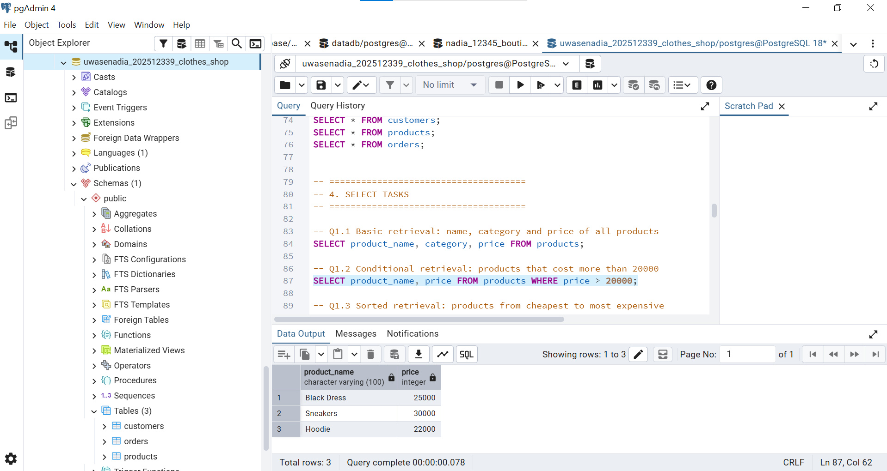

WHERE keeps only the expensive products.

**Q1.3** Objective: list products from cheapest to most expensive.

```sql
SELECT product_name, price FROM products ORDER BY price ASC;
```

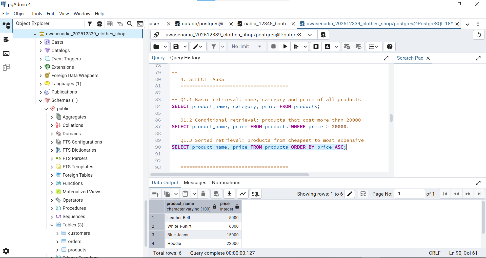

ORDER BY sorts the result by price.

### JOIN

**Q2.1** INNER JOIN. Objective: show orders with the customer name.

```sql
SELECT o.order_id, c.full_name, o.quantity, o.status
FROM orders o
INNER JOIN customers c ON o.customer_id = c.customer_id;
```

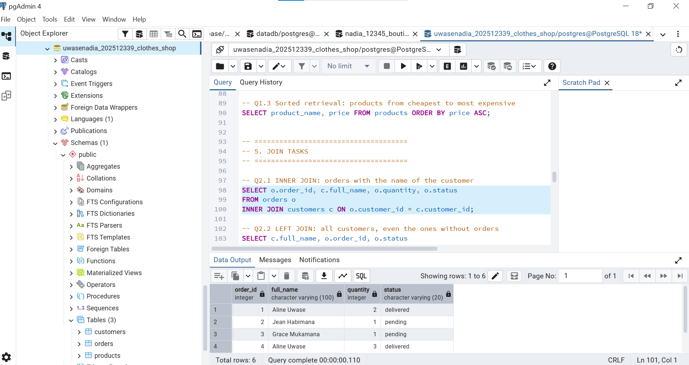

Only customers who have an order appear.

**Q2.2** LEFT JOIN. Objective: show all customers, even without orders.

```sql
SELECT c.full_name, o.order_id, o.status
FROM customers c
LEFT JOIN orders o ON c.customer_id = o.customer_id;
```

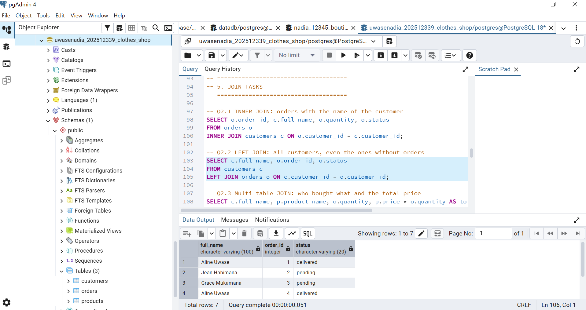

Diane has no order, so her order columns are NULL.

**Q2.3** Three tables. Objective: show who bought what and the total.

```sql
SELECT c.full_name, p.product_name, o.quantity, p.price * o.quantity AS total
FROM orders o
JOIN customers c ON o.customer_id = c.customer_id
JOIN products p ON o.product_id = p.product_id;
```

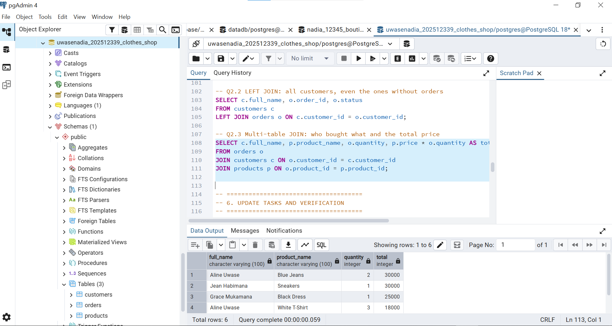

A sales report with the total for each order.

### UPDATE

**Q3.1** Objective: change the price of Blue Jeans.

```sql
SELECT product_name, price FROM products WHERE product_name = 'Blue Jeans';  -- before
UPDATE products SET price = 16000 WHERE product_name = 'Blue Jeans';
SELECT product_name, price FROM products WHERE product_name = 'Blue Jeans';  -- after
```

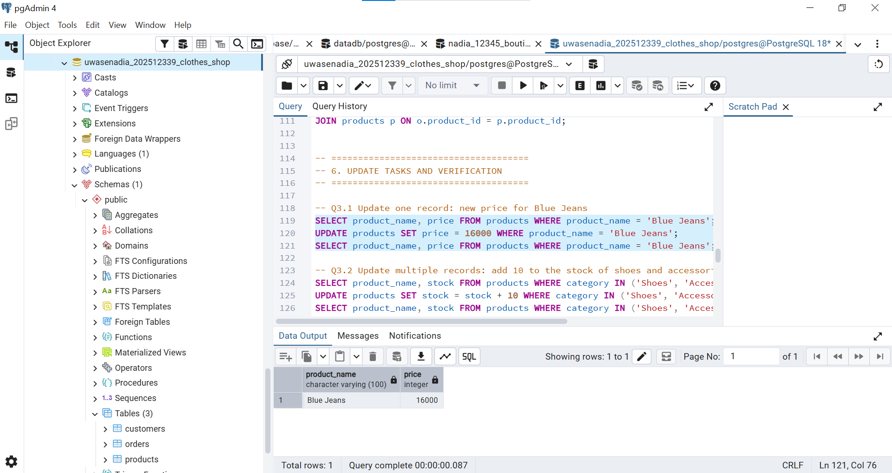

Only one product changed, checked with SELECT.

**Q3.2** Objective: add 10 to the stock of shoes and accessories.

```sql
SELECT product_name, stock FROM products WHERE category IN ('Shoes', 'Accessories');  -- before
UPDATE products SET stock = stock + 10 WHERE category IN ('Shoes', 'Accessories');
SELECT product_name, stock FROM products WHERE category IN ('Shoes', 'Accessories');  -- after
```

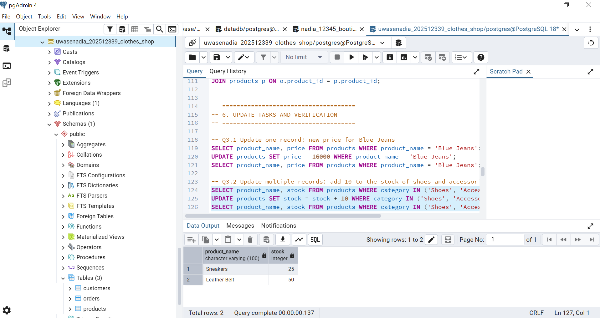

I first selected the rows to be sure which ones would change.

**Q3.3** Objective: pending orders before 20 October become delivered.

```sql
SELECT order_id, order_date, status FROM orders WHERE status = 'pending' AND order_date < '2026-10-20';  -- before
UPDATE orders SET status = 'delivered' WHERE status = 'pending' AND order_date < '2026-10-20';
SELECT order_id, order_date, status FROM orders ORDER BY order_id;  -- after
```

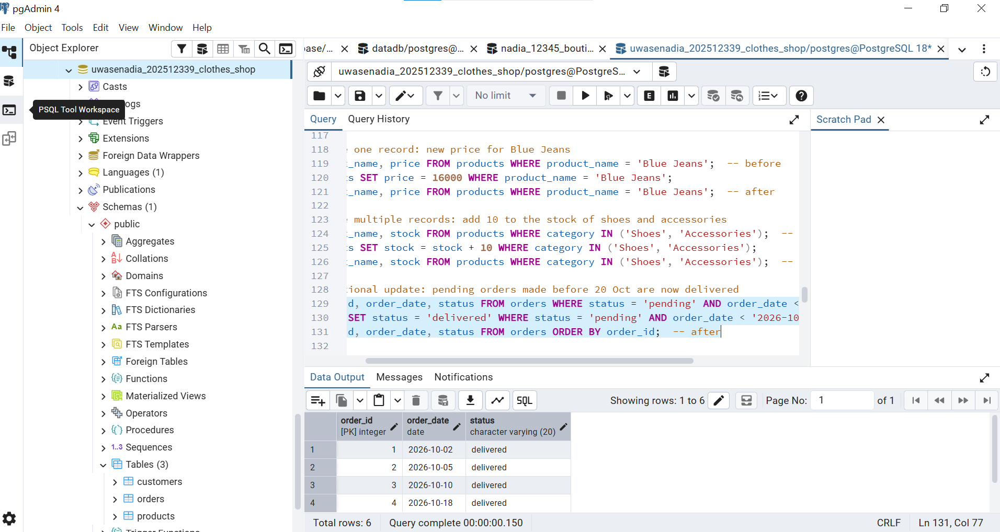

Old pending orders are delivered, the newer ones stay pending.

### ALTER TABLE

**Q4.1** Objective: rename phone to phone_number.

```sql
ALTER TABLE customers RENAME COLUMN phone TO phone_number;
SELECT * FROM customers;
```

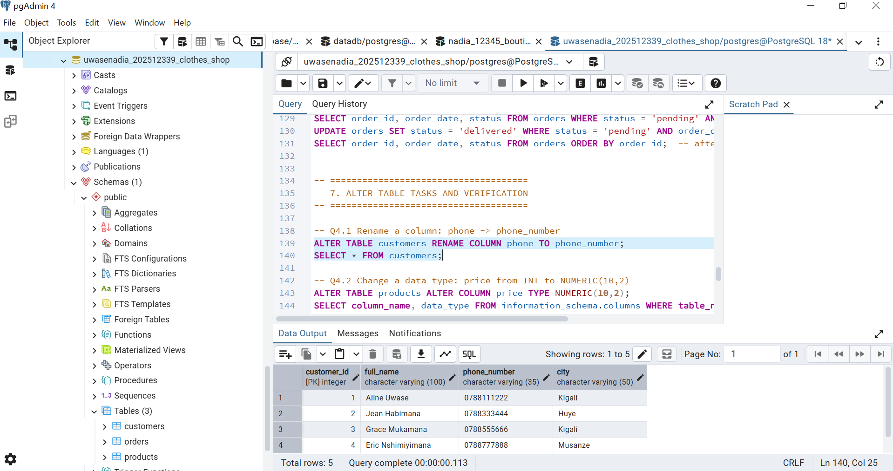

The column has the new name and the data is still there.

**Q4.2** Objective: change price from INT to NUMERIC(10,2).

```sql
ALTER TABLE products ALTER COLUMN price TYPE NUMERIC(10,2);
SELECT column_name, data_type FROM information_schema.columns WHERE table_name = 'products';
SELECT product_name, price FROM products;
```

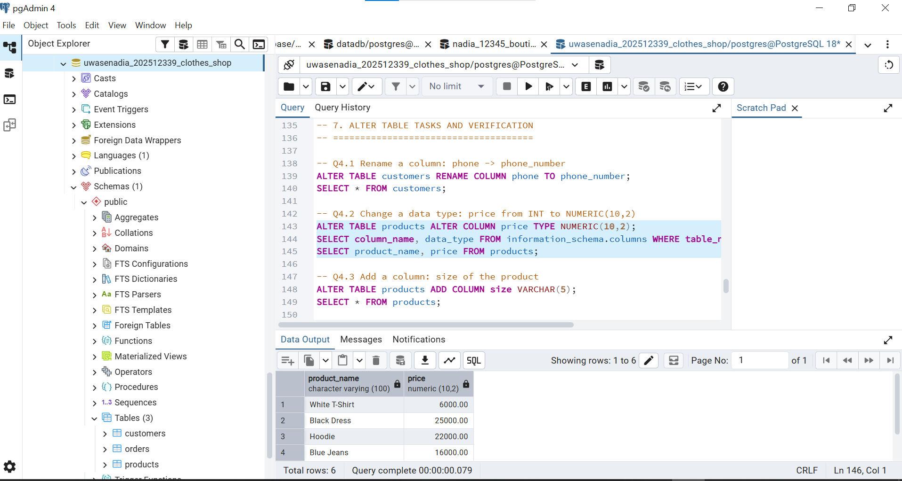

The old prices are kept, now with 2 decimals.

**Q4.3** Objective: add a size column.

```sql
ALTER TABLE products ADD COLUMN size VARCHAR(5);
SELECT * FROM products;
```

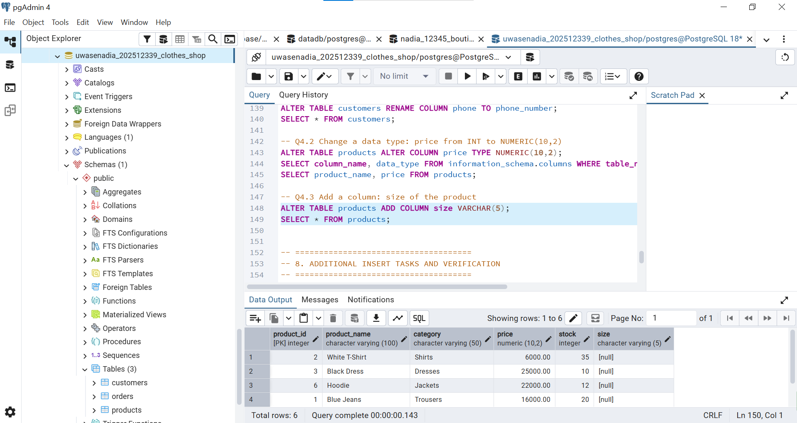

I added it because clothes have sizes. It is empty (NULL) for old products.

### INSERT

**Q5.1** Objective: insert one new customer.

```sql
INSERT INTO customers (full_name, phone_number, city) VALUES ('Patrick Niyonzima', '0788123456', 'Kigali');
SELECT * FROM customers;
```

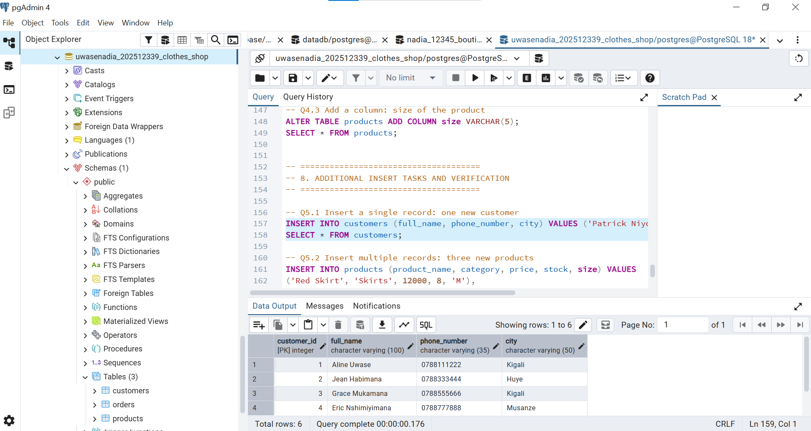

The customer got id 6 automatically.

**Q5.2** Objective: insert several new products.

```sql
INSERT INTO products (product_name, category, price, stock, size) VALUES
('Red Skirt', 'Skirts', 12000, 8, 'M'),
('Kitenge Shirt', 'Shirts', 18000, 14, 'L'),
('Cap', 'Accessories', 4000, 30, 'S');
SELECT * FROM products;
```

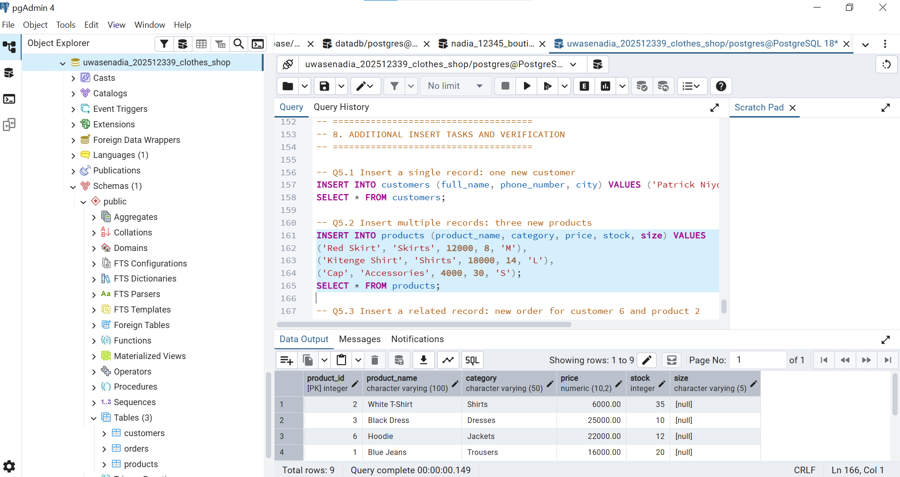

3 products were added with one statement.

**Q5.3** Objective: insert an order for customer 6 and product 2.

```sql
INSERT INTO orders (customer_id, product_id, quantity) VALUES (6, 2, 2);
SELECT * FROM orders;
```

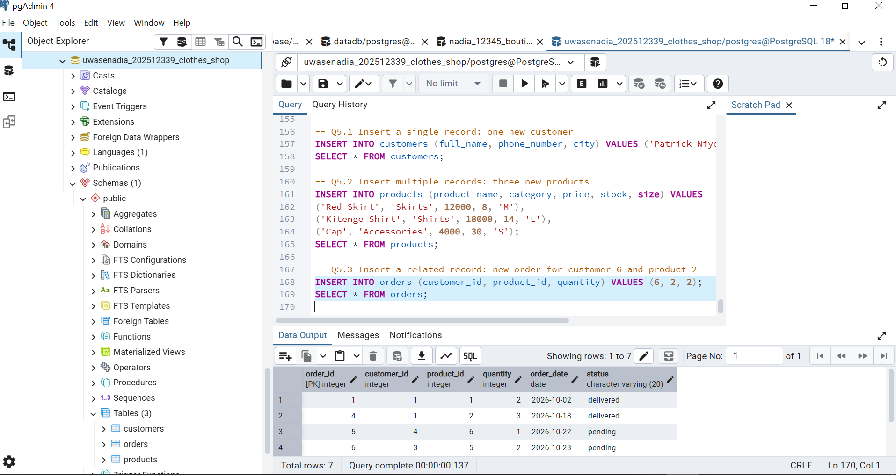

The foreign keys are valid because customer 6 and product 2 exist.

## 6. Conclusion
In this assignment I learned how to create tables in PostgreSQL and connect them with primary keys and foreign keys. I practised inserting and selecting data, and I saw the difference between INNER JOIN and LEFT JOIN. I also learned that UPDATE needs a WHERE condition so that only the right rows change, and that ALTER TABLE changes the structure of the table while UPDATE and INSERT change the data.
